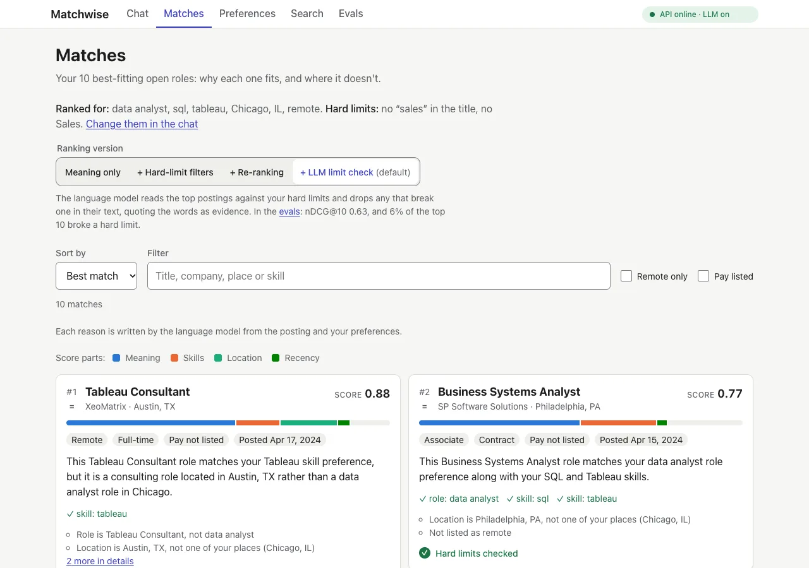
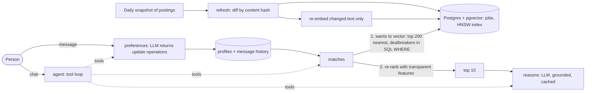
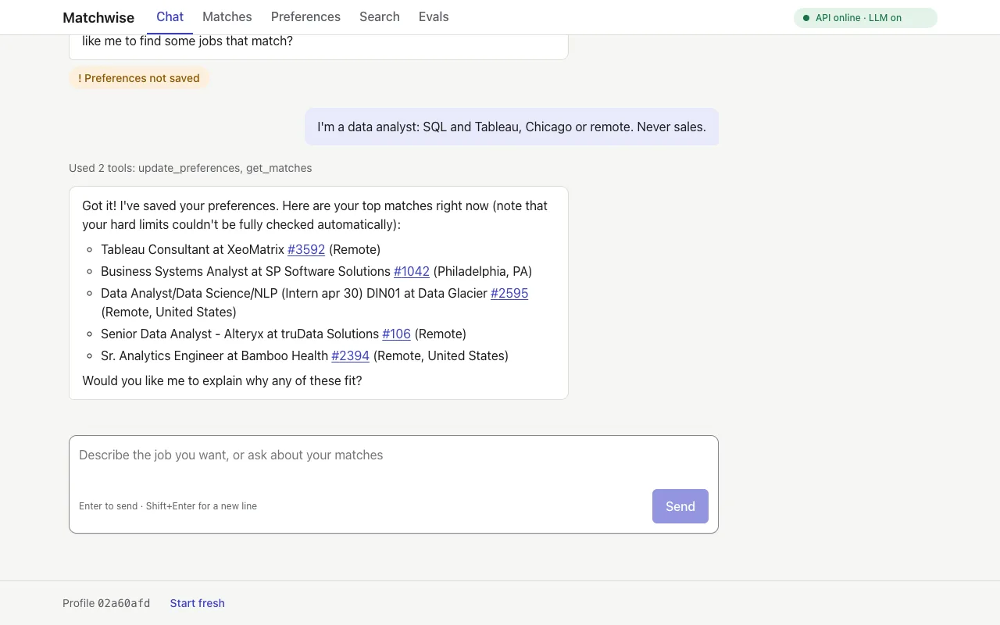
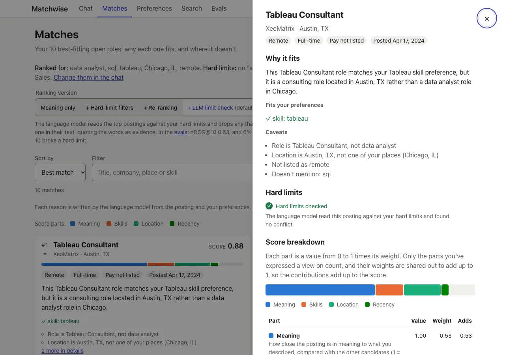
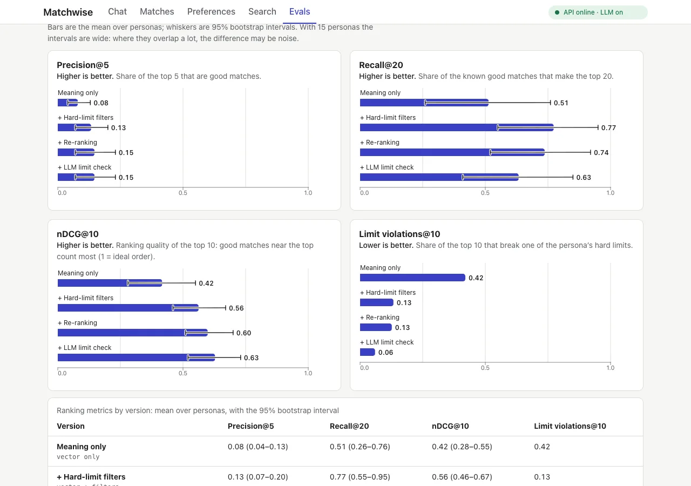
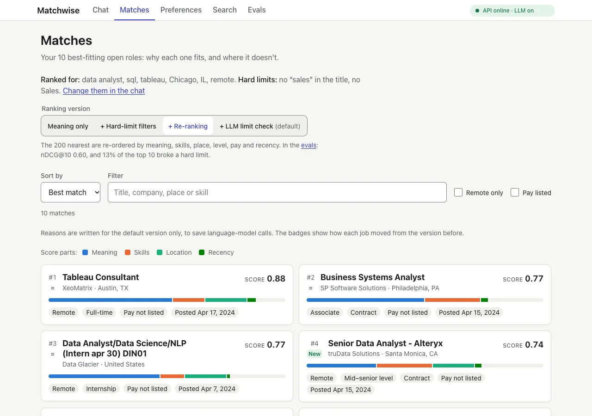
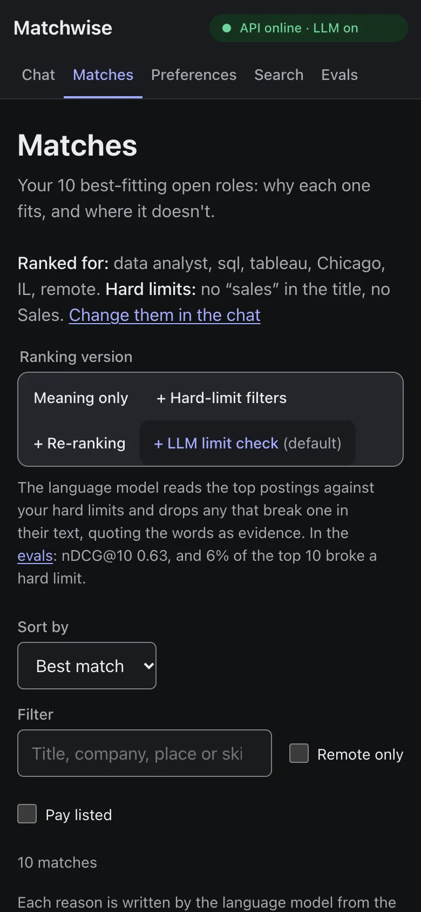
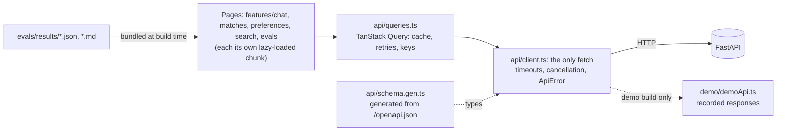

# Matchwise

Describe the job you want next, and what you'd never take, in plain words. Matchwise turns
that into stored preferences, finds fitting roles among thousands of postings that change
every day, ranks them, and says why each one fits, including where it doesn't. Its match
quality is measured with evals, and those evals drove most of the fixes below.

```text
YOU:   Hi! I'm a registered nurse. I want to stay in Texas and I won't do night shifts.
   [tool] update_preferences  [tool] get_matches
AGENT: Here are a few day-shift Registered Nurse positions in Texas that fit:
       * Registered Nurse at The US Oncology Network [#5185] in Austin, TX
       * Registered Nurse (RN) PRN 1 Emergency Room days at Houston Methodist [#5083] in Houston, TX
       ...
YOU:   Tell me more about the second one.
   [tool] explain_match(5083)
AGENT: ... matches your preference for a registered nurse role in Texas, and it's a day-shift
       position so it respects your dealbreaker. However, the salary is not stated in the listing.
```

Python 3.11 · FastAPI · Postgres 16 + pgvector (HNSW) · sentence-transformers (MiniLM, local) ·
Gemini (free tier) through one small client · Docker Compose · pytest ·
**web frontend:** React 18 · TypeScript · Vite · TanStack Query · Vitest · Cypress ([below](#web-frontend))



## How it works



1. **Preferences.** Each message goes to the LLM, which returns *operations* ("add 'Denver, CO'
   to wants.locations", "remove 'Sales' from dealbreakers"). They're validated with Pydantic and
   applied in Python. Soft **wants** rank jobs; hard **dealbreakers** filter them.
2. **Two-stage matching.** Stage 1 embeds the wants and takes the 200 nearest postings that pass
   every dealbreaker, all in one SQL query. Stage 2 re-ranks them with features anyone can read:
   similarity, skills overlap, location, seniority, salary, recency.
3. **Reasons.** For each match, the LLM writes why it fits, using only the posting and the stated
   preferences, then lists matched preferences and caveats. Reasons are cached by posting content
   × preferences × prompt × model.
4. **Daily refresh.** A snapshot is diffed by content hash. Only postings whose *embedded text*
   changed are re-embedded, and removed ones are soft-deleted.
5. **Agent.** A hand-written tool loop over `update_preferences`, `get_matches`, `search_jobs` and
   `explain_match`. It remembers the conversation and the stored preferences.

## Run it

You need Docker, the dataset and (for preferences, reasons and chat) a free Gemini API key.

```bash
cp .env.example .env
```

1. In `.env`, set `LLM_API_KEY` (from https://aistudio.google.com/apikey). Search and matching
   work without it.
2. Download the [LinkedIn Job Postings dataset](https://www.kaggle.com/datasets/arshkon/linkedin-job-postings)
   and unzip it into `data/raw/` (details in [data/README.md](data/README.md)).
3. Start everything:

```bash
docker compose up
```

The first start loads a seeded sample of 5,000 postings and embeds them (about 4 minutes on a
laptop CPU). Later starts skip that. Then open http://localhost:8000/docs, or:

```bash
curl -s -X POST localhost:8000/profiles/me/messages -H 'content-type: application/json' -d '{"message": "Mid-level backend engineer, Python and PostgreSQL, remote please. Never sales."}'
```

```bash
curl -s "localhost:8000/profiles/me/matches?limit=5"
```

| Endpoint | What it does |
|---|---|
| `GET /search?q=` | semantic search over open postings |
| `POST /profiles/{id}/messages` | update preferences from a plain-language message |
| `GET /profiles/{id}` · `/messages` | current preferences · how each message changed them |
| `GET /profiles/{id}/matches` | top matches with score breakdown, reasons and `limit_check` status (default `mode=checked` with an LLM; also `full`, `vector_filters`, `vector`; `explain=false`) |
| `POST /profiles/{id}/chat` · `GET` · `DELETE` | talk to the agent · the conversation with every tool call · forget it |
| `GET /jobs/{id}` | one posting with its full description |
| `GET /health` | counts and whether the LLM is configured |

Daily refresh: `docker compose run --rm app python -m matchwise.refresh day --seed 1`
simulates and applies a day of churn.

## Web frontend

A React app in [`web/`](web) for everything above: talk to the agent, see your matches and why they fit,
compare the four ranking versions, follow how each message changed your preferences, search, and read the evals.

| Chat | Details | Evals |
|---|---|---|
|  |  |  |
| **Ranking versions** | **Phone, dark mode** | |
|  |  | |

Screenshots from the production build against the real API (`docs/screenshots/`).

**Public demo.** A free host can't run the API well (it needs about 465 MB of RAM, and the free LLM tier is shared
by every visitor through an API with no authentication), so the public link is a **demo build**: it replays
responses recorded from the real API, in the browser, and says so on every page. How it's deployed, the free
options and their limits: [docs/web-deployment.md](docs/web-deployment.md).

### Run it locally

Start the API first (`docker compose up`, above), then, with Node 22 (`web/.nvmrc`):

```bash
cd web && nvm use && npm ci && npm run dev
```

Open http://localhost:5173. The only setting is `VITE_API_URL` (default `http://localhost:8000`; see
`web/.env.example`); the API allows the dev and preview origins through `CORS_ORIGINS`.

| Command (in `web/`) | What it does |
|---|---|
| `npm run check` | formatting, lint, types, unit and component tests with coverage |
| `npm run e2e` | Cypress on the production build, replaying responses recorded from the API |
| `npm run e2e:live` | the same flow against the running API and its LLM (slow, uses quota) |
| `npm run build:demo` · `npm run e2e:demo` | the demo build, and its test (no backend at all) |
| `npm run lighthouse -- <label>` | Lighthouse on the production build (`npm run preview` first) |
| `npm run api:sync` | regenerates the TypeScript types from the running API's OpenAPI schema |

### How it's built



- **Server data** lives in TanStack Query's cache, keyed so that invalidation can't miss: matches are keyed by the
  profile's version, so a preference change can never show an old ranking.
- **UI state that should survive a reload or be shareable lives in the URL:** sort and filters, the ranking
  version, the open job (`?job=`), the search text.
- **Styling** is CSS Modules on design tokens (CSS custom properties, light and dark), with no UI kit.
- **Folders:** `api/` (client, generated types, query hooks), `app/` (layout, routes, health, errors),
  `features/<page>/`, `ui/` (shared components), `lib/` (formatting, small hooks), `data/` (ranking versions and
  eval results), `demo/` (recordings), `styles/` (tokens).

### Quality

Lighthouse on the production build, mobile settings, median of 3 runs
([details and before/after](web/docs/accessibility-performance.md)):

| Page | Performance | Accessibility | Best practices | SEO | LCP | CLS |
|---|---|---|---|---|---|---|
| Chat | 100 | 100 | 100 | 100 | 1.37 s | 0 |
| Matches | 100 | 100 | 100 | 100 | 1.45 s | 0 |
| Preferences | 100 | 100 | 100 | 100 | 1.38 s | 0 |
| Search | 100 | 100 | 100 | 100 | 1.39 s | 0 |
| Evals | 100 | 100 | 100 | 100 | 1.22 s | 0 |

- **Accessibility beyond Lighthouse:** axe-core finds no violations in real Chrome on seven views, in light and dark
  mode; every page works by keyboard, at 320 px wide, at 200% text and in forced-colours (high-contrast) mode.
- **Tests:** 218 unit and component tests (Vitest and Testing Library, with axe on every page). Coverage: 96%
  of statements, 87% of branches, 96% of functions, 98% of lines, with thresholds that fail the build if it
  drops.
- **End to end (Cypress):** the main flow (a new person describes what they want in the chat, and their matches
  appear) runs on responses recorded from the API in CI, against the live stack on request, and on the demo
  build, which must work with no backend.
- **CI:** [.github/workflows/web.yml](.github/workflows/web.yml) runs all of it on every push that touches `web/`.

### Key decisions (frontend)

- **Types generated from the API's OpenAPI schema,** not written by hand. A backend test compares the live schema
  with the copy the types came from, so the frontend can't drift from the API unnoticed. The backend was changed
  where the frontend needed it: typed responses and errors, `GET /jobs/{id}`, CORS from an environment variable,
  gzip, and an agent that can no longer say "saved" when the save failed (each in its own commit, with tests).
- **TanStack Query instead of fetching in `useEffect`:** caching, deduplication, cancellation and retries in one
  place. Retries only where they can help (network errors, a busy LLM), never for chat messages, which would be
  saved twice.
- **Matches load in two steps:** the ranked list (about 0.1 s) shows at once and the reasons (8–12 s the first
  time) fill in after, with their space reserved, so nothing jumps.
- **LLM output is untrusted input:** replies are rendered by a small parser into elements, never as HTML; and
  where the agent's words and its tool results disagree, the UI shows the tool results.
- **Native HTML first:** `<dialog>` for the drawer and confirmations (focus trap and Escape built in), `<details>`
  for the tools-used line, real radio buttons for the ranking versions, `role="log"` for the conversation.
- **Performance from measurement:** route-level code splitting, a long-lived vendor chunk, layout shifts traced to
  their elements and removed, and one `React.memo`, where the profiler showed typing re-rendering every past chat
  turn (11.3 ms → 0.28 ms per keystroke).
- **The demo is honest by construction:** recordings come from the real API, every page says they're recordings,
  and the bundler drops the demo code from normal builds.

### Security, and what "no authentication" means for a demo

The frontend holds no secrets: its only settings are the API's address and the demo switch, and anything in a
`VITE_` variable is public. The API has **no authentication yet** ([docs/deployment.md](docs/deployment.md)): a
profile id is the only key, and anyone who can reach the API can call it and spend its LLM quota. CORS doesn't
change that; it only stops other websites from calling it from a visitor's browser. That's why the public link is
the demo build, and why a live backend should stay private until it has sign-in and rate limits. The hosting
config adds a Content Security Policy and other security headers ([docs/web-deployment.md](docs/web-deployment.md)).

## Evals

Everything here can be traced to files in [evals/](evals/README.md): 15 personas written in their
own words, their frozen extracted preferences, the labelling pool, the labels, and the judge's
scores.

### Ranking: vector-only vs + filters vs + re-ranking

| Version | P@5 | R@20 | nDCG@10 | violations@10 | judged@10 |
|---|---|---|---|---|---|
| vector only | 0.08 (0.04–0.13) | 0.51 (0.26–0.76) | 0.42 (0.28–0.55) | 0.42 | 1.00 |
| vector + filters | 0.13 (0.07–0.20) | 0.77 (0.55–0.95) | 0.56 (0.46–0.67) | 0.13 | 1.00 |
| vector + filters + re-ranking | 0.15 (0.07–0.23) | 0.74 (0.52–0.92) | 0.60 (0.51–0.70) | 0.13 | 1.00 |
| **+ LLM limit check** (default) | 0.15 (0.07–0.23) | 0.63 (0.41–0.85) | 0.63 (0.52–0.73) | **0.06** | 1.00 |

15 personas, 588 labelled postings (31 good matches). R@20 covers the 11 personas with at
least one good match. Brackets: 95% bootstrap interval over personas.
([results/ranking.md](evals/results/ranking.md), per persona in [ranking.json](evals/results/ranking.json))

**Who labelled.** The labels were made by **Claude (claude-opus-5-5) acting as an
independent labeller, not by a person**, because there wasn't time for a person to label
588 postings. It's a different model family from the Gemini models the system uses. It saw only
the posting text and each persona's own words, never which version found a posting, and wrote
a short note for every label (`evals/labels.jsonl`). The obvious next step is a human
spot-check of a sample: `python -m evals.label` records `labeller: human`.

What changed between versions, and why the numbers moved (paired change per persona, 95% interval):
- **+ filters** (dealbreakers as SQL `WHERE` inside the vector search): violations@10
  **−0.29** (−0.46 to −0.13), nDCG@10 **+0.15** (+0.03 to +0.29). Vector-only search fills
  the top 10 with jobs the person ruled out, because embeddings can't express "never sales" or
  "remote only". Removing those lets good jobs move up.
- **+ re-ranking** (skills, location, seniority, salary, recency): nDCG@10 **+0.04** (−0.00 to
  +0.08), P@5 +0.01, R@20 −0.04 (−0.30 to +0.24). The gain is small, and 15 personas can't
  separate it from zero. The features mostly reorder jobs the filters already got right.
- **+ LLM limit check** ([limit_check.py](matchwise/limit_check.py)): violations@10 **−0.07**
  (−0.11 to −0.03), nDCG@10 **+0.03** (+0.00 to +0.07), P@5 unchanged, R@20 **−0.10**
  (−0.29 to 0.00). It halves the violations the filters miss, at a cost in recall.
- **Low P@5 is mostly the data.** 5,000 postings spread across the whole US contain only 31
  good fits for these 15 personas, and 4 personas have none (there are no elementary teaching
  jobs in California in the sample, for example).

**Why the LLM limit check was added.** Without it, 19 of the full system's 150 top-10 slots
(13%) broke a stated limit, all in ways the structured filters can't see:

| Cause | Examples from the labels |
|---|---|
| the limit is only stated in free text | "6-month contract via consulting firm"; "plaintiff personal injury law firm"; "weekend emergency call required" |
| pay is only stated in the description | "pay tops at $85K" for someone who needs $90k (the structured salary field was empty) |
| wording the phrase filter misses | a title ending "…Nights" against the limit "night shift" |
| wrong structured data | a "remote" flag on an in-store welcome desk job |

So after re-ranking, the LLM reads the top jobs against the person's numbered limits and drops
the ones that break one. False alarms would quietly hide good jobs, so every flag has to be proven:
- it may only cite the person's own limits (L1, L2, …);
- it must quote the posting, and code checks the quote is really there;
- missing information never counts as a violation.

Checking every job it dropped against the labels:

| Limit-check prompt | Dropped | Really break a limit | Okay/good jobs wrongly dropped | Precision (labelled drops) |
|---|---|---|---|---|
| limits-v1 | 51 | 20 | 9 (4 good) | 56% |
| limits-v2 | 37 | 16 | 4 (3 good) | 62% |

v1 read "no audit roles" as "never mentions audits", and dropped an in-house controller who
"coordinates annual audits". v2 says a role limit is broken only when the job *is* that role.
v2 was written after seeing v1's mistakes on these same personas, so its numbers are somewhat
optimistic; new personas would be the clean test. What v2 still gets wrong:
- "remote only" read too literally (remote jobs with in-person training);
- "rotating nights" vs "overnight shifts";
- one arithmetic slip, flagging "$60,000–$75,000" as below a $55,000 minimum. Numeric
  comparisons belong in code, not in an LLM.

**The 0% target is still not met: 6% of the top 10 break a limit.** If the LLM is down, the
check *fails open*: cached verdicts still apply, the other jobs are kept, and each match says
`limit_check: "skipped"`. An outage never hides every job, and never goes unnoticed. The evals
run in strict mode instead, where a failed check stops the run rather than producing numbers
from a half-done check.

Method. Each persona's labelling pool is the union of every version's top 20 plus 10
keyword-search hits, shown shuffled with the source hidden. Postings are graded
2 / 1 / 0 against what the persona *said*, plus a flag for ones that break a stated limit.
Metrics:
- **P@5:** what someone sees first.
- **R@20:** do good jobs survive retrieval and filtering.
- **nDCG@10:** are better jobs higher.
- **violations@10:** checked against the labeller's flags, not the filter code, so 0% isn't
  true by construction.
- **judged@10:** how much of the top 10 is labelled.

### Reason quality: prompt v1 vs v2

Each persona's top 5 matches (the same 75 postings for both prompts), scored 1–5 by an LLM judge:

| Reasons prompt | Specific | Grounded | Honest | n |
|---|---|---|---|---|
| reasons-v1 | 4.59 | 3.77 | 3.31 | 75 |
| reasons-v2 | 4.85 | 4.32 | 4.55 | 75 |
| change (95% CI) | +0.27 (+0.09 to +0.44) | +0.55 (+0.35 to +0.76) | +1.24 (+0.75 to +1.76) | 75 pairs |

What changed and why the numbers moved. The judge's notes on v1 showed three problems:
- **Adjacent roles counted as matches**, e.g. a patient-care technician job "matching" *nurse*.
- **Role mismatches not mentioned**, e.g. a DevOps job offered to someone who wants backend work.
- **No limit violations ever flagged.** The v1 prompt told the writer every job had already
  passed the filters, so it never looked.

v2 counts a role only if the posting *is* that role, says plainly when the role differs, and
must list any "Possible conflict with your limit" first. **Honest** moved most because the
caveats now include those conflicts.

The judge is `gemini-3.1-flash-lite`: a different model from the writer
(`gemini-3.5-flash-lite`), but the same family. `gemini-3.5-flash` would be a stronger judge,
but its free tier allowed only about 10 requests a day.

**Can the judge be trusted?** An independent reviewer scored a random 20 of the v2 reasons
without seeing the judge's scores. As with the labels, this was Claude (claude-opus-5-5), not a
person.

| Dimension | Exact agreement | Within 1 point | Mean abs. difference | Judge mean | Reference mean | n |
|---|---|---|---|---|---|---|
| specific | 10% | 75% | 1.15 | 4.80 | 3.75 | 20 |
| grounded | 35% | 55% | 1.15 | 4.00 | 3.65 | 20 |
| honest | 45% | 80% | 0.80 | 4.30 | 3.80 | 20 |

The judge is consistently more generous, by 0.35 to 1.05 points. Its absolute scores are
inflated, so don't read 4.85 as "nearly perfect". The v1 → v2 comparison still holds, because
both prompts were judged by the same judge on the same postings. A stronger judge model, or
human scores, would sharpen it.

### Extraction review (15 personas, read by hand)

| Preferences prompt | Severe errors | Minor issues |
|---|---|---|
| v1 | 2 / 15 | 3 |
| v2 | 0 / 15 | 2 |

v1 turned "no audit roles" (an accountant) and "no substitute teaching" (a teacher) into
excluding the person's *own* job function, which would have hidden almost every relevant job.
Details: [evals/results/extraction_review.md](evals/results/extraction_review.md).

### Search index: HNSW vs exact scan

200 queries over 5,000 vectors, k = 10 (`python -m evals.hnsw_recall`):

| Method | recall@10 | p50 ms | p95 ms |
|---|---|---|---|
| Exact scan | 1.000 | 2.93 | 3.48 |
| HNSW, ef_search = 40 (default) | 0.985 | 0.20 | 0.26 |
| HNSW, ef_search = 100 (used) | 0.996 | 0.32 | 0.49 |

### Daily refresh

Three simulated days, each removing 3%, editing 5% and adding 150 postings:

| Step | Time |
|---|---|
| Apply the snapshot (one transaction) | 0.86–0.99 s |
| Re-embed (266–271 of 5,000) | 12.5–13.5 s |
| Re-embed everything, for comparison | 204 s |
| Re-apply the same snapshot | 1.9 s, nothing re-embedded |

242 postings changed each day, but only about 120 needed new vectors: salary edits and edits
past the embedded part of the description don't change the embedded text.

### What the evals and tests changed

| Found | Fix |
|---|---|
| Extractor excluded people's own job function (2/15 personas) | prompt v2 with explicit rule and live regression tests |
| Remote-flagged field jobs passed location limits: up to 12 of the HVAC technician's top 20 were outside PA/NJ | remote passes a location limit only if the person said remote is fine: 0 of 20 |
| Reasons over-claimed roles and never flagged limit conflicts | reasons prompt v2 (table above) |
| Judge called true claims "invented" (it saw only the first 2,500 characters) | judge v2 sees the whole posting and its skill tags |
| "day shifts. sign-on bonus" in the query pulled in non-nursing jobs (cosine 0.64 → 0.54) | query vector = core wants + 0.3 × extras |
| "Travel Nurse" title passed a "travel nursing" limit | phrase limits check title + description and match word forms |
| 2% of salaries implausible (hourly figures labelled yearly) | treated as unknown rather than guessed |
| "recruiting" tagged on 13% of postings, mostly from hiring boilerplate | boilerplate stripped; self-referential terms dropped from the vocabulary |
| 13% of top-10 results broke a limit only stated in free text | LLM limit check with proven evidence: 6% |
| The limit check read "no audit roles" as "never mentions audits" (9 okay/good jobs dropped) | limits-v2: a role limit applies only if the job *is* that role (4 dropped) |
| When the LLM was down, the limit check was silently skipped | each match reports `limit_check`; cached verdicts still apply; evals run strict |
| PostgreSQL 16.12 bug broke `left()` on 13 postings | moved to 16.15, regression test |

## Key decisions

- **pgvector with HNSW, not IVFFlat.** HNSW needs no training and takes inserts as they come,
  which suits postings that change daily. IVFFlat's clusters are fitted once and drift as data
  churns. At 5,000 rows an exact scan is also fast (3 ms), so the table above is about how it
  will behave at millions.
- **One vector per posting, from a "job card", not chunks.** MiniLM reads 256 tokens and drops
  the rest, so we embed title, level, place, skills and the first 800 characters of the
  description. That length was measured: 99% of cards fit. Chunking adds rows and a
  max-over-chunks step for little gain at this size.
- **Embed the wants, never the dealbreakers.** Embeddings don't understand negation: searching
  "not sales" returns *only* sales jobs. So dealbreakers are SQL filters.
- **Filters inside the vector query.** Filtering a top-200 list afterwards can leave 3 results.
  With pgvector's iterative index scan, the index keeps searching until enough rows pass.
- **An LLM checks hard limits after the SQL filters, and each flag must be proven.** Filters
  only see structured fields, so the LLM reads the top jobs against the person's numbered
  limits. A flag counts only if it cites one of those limits and quotes the posting, and code
  checks the quote is really there. If the LLM is down, the check fails open but visibly
  (`limit_check: "skipped"`): an outage shouldn't hide every job.
- **Two stages.** Vector search is cheap and good at "roughly the right kind of job". Feature
  re-ranking is precise but needs structured fields, so it runs on 200 candidates. Every score
  is returned with its breakdown. The weights are hand-set and documented, not tuned on the
  eval set.
- **The LLM returns operations, not a rewritten state.** A model rewriting everything can quietly
  drop an earlier preference. Operations make every change visible in the history and testable
  without an LLM.
- **Validation is ours.** Every LLM reply is checked with Pydantic, plus request-specific rules
  (e.g. "only these preference IDs"). Errors go back to the model for another try, then fail
  cleanly. Provider-side schema enforcement isn't relied on.
- **Grounding is checked, not just requested.** Preferences get IDs (W1, W2…), so "matched
  preferences" can be verified in code. Gaps visible in the data ("salary not stated") are passed
  to the writer as facts.
- **Two hashes per posting.** `content_hash` says whether the posting changed (row update, reason
  cache miss). `embedded_hash` says whether the embedded text changed (new vector). Removed
  postings are soft-deleted, so labels and history never point at nothing.
- **Optimistic locking for preferences.** No database lock is held during the LLM call. The save
  succeeds only if the profile's version is unchanged.
- **Evals built to be trusted.** Pooled labels judged against the persona's words; violations
  checked by the labeller, not the filter code; paired comparisons with intervals over personas;
  frozen preferences so numbers don't drift with the LLM. Every label and reference score records
  who made it, and this README says plainly that they came from a model.

## How this would scale to millions of postings re-read every morning

Full notes, built on the measured numbers above: [docs/scaling.md](docs/scaling.md).

- **Diff in SQL, not Python:** stream the feed into a staging table with `COPY`, then one
  set-based insert, update and anti-join for removals. The truncated-feed guard becomes a count
  on the staging table.
- **Embedding as a queue:** changed rows are picked up by workers in batches (`SKIP LOCKED` or
  SQS/Kafka); hashes make retries harmless. At 3–5% churn, 1M postings is about 30–55k
  embeddings a day. That's about 40 minutes on one CPU container at the measured ~21/s, or
  minutes on a GPU. Store a `card_hash` column so finding changed rows doesn't mean hashing every
  card (1.1 s at 5k, about 4 minutes at 1M).
- **HNSW updated in place:** vacuum dead entries, recheck recall on a schedule, `halfvec` to
  halve memory (1M × 384 floats ≈ 1.5 GB), and a partial index on active rows.
- **Selective filters:** the iterative scan stops after 20,000 rows. Partition by region, or let
  the planner do an exact search over a small filtered subset.
- **Reasons stay lazy:** generated when someone views a match and cached by content, never
  precomputed for every person × posting.

## Project layout

```
matchwise/   ingest · embeddings · search · preferences · filters · places · ranking ·
             reasons · refresh · agent · llm · api · db · bootstrap
migrations/  numbered SQL files, applied at startup under an advisory lock
evals/       personas, frozen preferences, pool, labels, metrics, ranking runner, judge
docs/        scaling.md · deployment.md · web-deployment.md · screenshots/
tests/       230 tests (pytest); 4 live LLM tests behind `-m live`
web/         the React frontend (see "Web frontend"): src/, cypress/, scripts/, docs/
```

Run the tests:

```bash
docker compose run --rm app pytest
```

Live tests use your API quota, so they only run when asked:

```bash
docker compose run --rm app pytest -m live
```

## Limitations and next steps

- **Dealbreakers still leak: 6% of top-10 slots, not 0%,** even with the LLM limit check, and
  the check costs some recall (R@20 −0.10). Next: do numeric limits (pay) in code instead of
  the LLM, test limits-v2 on fresh personas, and offer the person "show me what was filtered
  out" rather than hiding borderline jobs entirely.
- **The labels and judge check came from a model.** A human spot-check of a sample of labels
  and reason scores is the next step.
- **LightGBM re-ranker**, trained on the labels with leave-one-persona-out validation. With 15
  personas it may not beat the hand-set weights, and that's worth reporting either way.
- Metro areas without a state ("Greater Houston") don't match a state-only place.
- No authentication yet; see [docs/deployment.md](docs/deployment.md). It's why the public web link is a
  recorded demo ([docs/web-deployment.md](docs/web-deployment.md)).
- On the free tier a chat turn takes 20–30 s, almost all of it waiting on our own rate limit.

## Data and licence

Postings: [LinkedIn Job Postings (2023–2024)](https://www.kaggle.com/datasets/arshkon/linkedin-job-postings)
by Kaggle user arshkon, CC BY-SA 4.0. The data isn't committed; eval files that contain posting titles
are derived data under the same licence.
